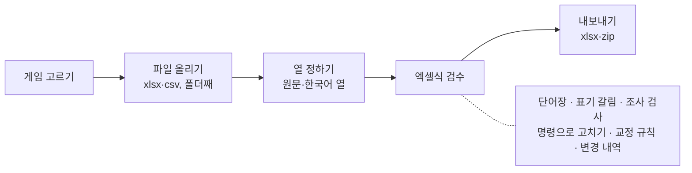
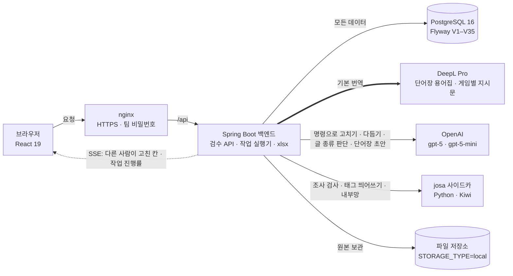
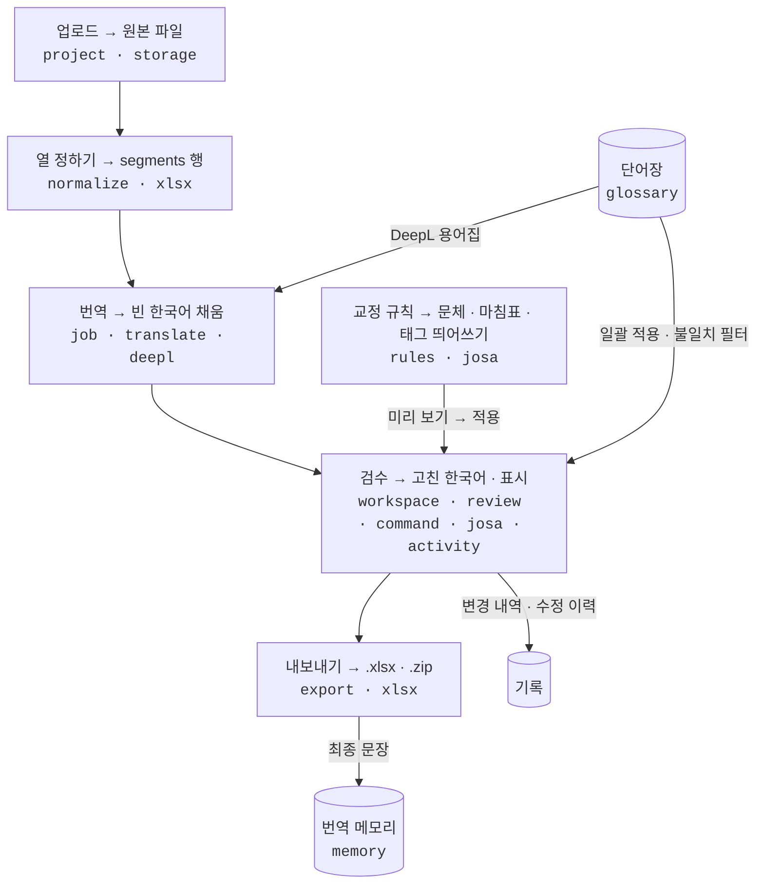

# 게임 번역 검수 도구

중국어(간체) 게임 텍스트를 한국어로 옮긴 엑셀 파일을 **팀이 함께 검수하고 고치는 웹 도구**.
파일을 올리면 엑셀처럼 생긴 화면에서 원문·기존 번역·고친 번역을 나란히 보고, 용어 통일·조사·띄어쓰기·문체 같은
반복 수정은 도구와 GPT에 맡긴 뒤, 원본 형식 그대로 한국어 열이 채워진 xlsx를 내려받는다.



## 무엇을 할 수 있나

**엑셀식 검수 화면** (`/review/:id`, 게임 전체는 `/games/:gameId/review`)
- 시트·페이지 단위 그리드. 칸을 고쳐 바로 저장하고, 같은 파일을 연 사람끼리 실시간으로 보인다(SSE).
- 엑셀처럼 범위를 드래그로 골라 복사·붙여넣기하고, **Ctrl+Z / Ctrl+Y**로 되돌리고 다시 한다.
  붙여넣기·일괄 수정은 한 단위로 되돌린다. 표 위 입력줄은 높이를 끌어 바꾼다.
- 범위 우클릭: 원문 범위를 **DeepL·GPT로 다시 번역**하거나, 고친 번역 범위를 **GPT로 다듬어** 전·후를 보고 고른 행만 넣는다.
  게임마다 GPT 번역·다듬기에 덧붙일 지시문을 둔다.
- 검수 표시: 체크 A·B·C · 확인 필요 · 비고 · **확정**. 확정한 행은 일괄 수정 도구가 건드리지 않는다.
- 최종 리뷰 레인: 최종 리뷰에서 고친 칸을 따로 표시하고, 최종 수정분만 골라 내보낼 수 있다.
- 필터: 수정됨 · 확정 안 함 · 확인 필요 · 내 담당 · 용어 불일치 · 조사 확인 · 동일 원문 불일치 · Fix 비어 있음 등.
- 행마다 고친 사람·이력, 같은 원문 모아 보기(×N), 길이 초과 줄이기(GPT 후보), 셀 우클릭 번역.
- **변경 내역** 패널: 누가 무엇을 고쳤는지 시간순으로 보고, 일괄 수정은 한 번에 되돌린다.
- 게임 전체 검수: 게임의 모든 파일을 한 화면에서 보고, 전체 파일을 zip으로 내보낸다.
- **게임 메모**: 검수 화면 메모 버튼으로 새 창을 열어 팀이 함께 쓰는 게임별 메모(서식 있는 편집기, 자동 저장).

**용어 통일**
- 게임마다 **단어장**(확정 용어)을 두고, 검수 화면 옆 패널에서 보고 고치고 일괄 적용한다. 단어장은 DeepL 번역에도 용어집으로 들어간다.
- **단어장 요청양식**: 요청 파일을 올리면 기존 표기와 대조하고 GPT 초안을 붙여, 한 표에서 승인한다.
  GPT가 실제 행을 열어 보고 지금 쓰인 표기를 골라 주는 "표기 확인"도 있다.
- 같은 원문이 여러 행에 있으면 한 곳을 고칠 때 나머지도 맞춘다(동일 원문 동기화).
- **표기 갈림** 화면: 같은 중국어 구절이 여러 한국어로 옮겨진 곳을 찾아 고유명사·수치·문법 조각 등으로 나눠 보여 준다.
- 예전 표기가 남아 있는 행을 찾아 새 확정 용어로 바꿀 것을 제안한다.

**자동 검사·일괄 수정**
- **조사 검사**: 용어를 바꾼 뒤 어긋난 조사(을/를, 이/가, 으로/로…)를 한국어 형태소 분석기(Kiwi)로 찾아 고칠 것을 제안한다.
- **명령으로 고치기**: "구미호를 여우로 바꾸고 조사도 맞춰줘"처럼 적으면 GPT가 도구(찾아 바꾸기·용어 바꾸기·조사 맞추기·태그 띄어쓰기·
  같은 원문 통일·길이 줄이기)로 시트에 시험해 본 뒤 변경 전·후를 보여 주고, 고른 행만 고친다. 태그·자리표시자 안쪽은 바꾸지 않는다.

**교정 규칙** (`/games/:gameId/rules`, 검수 화면 위 막대의 버튼) — 게임 전체에서 기계적으로 고칠 곳을 찾아 미리 보기로 고른 행만 고친다.
- **문체: 서술식 → 개조식**. "~습니다·~하세요·~한다"가 남은 행을 글 종류(효과·아이템·퀘스트·시스템 알림·도움말·이야기·UI…)별로 찾아
  "~함·~됨·명사"로 바꾼다. 대사·공지·메일은 바꾸지 않는다. 글 종류는 GPT가 행마다 한 번 판단해 저장한다(그 버튼만 비용이 든다).
  사람이 손으로 고친 기록이 있으면 그 종류에서 바꾼 비율을 참고로 보여 준다.
- **줄 끝 마침표 빼기**: 줄바꿈(`<br>`·줄바꿈)이나 글 끝 바로 앞의 "." 하나만 지운다. 말줄임표·소수점은 그대로.
- **태그 띄어쓰기**: `<color>` 같은 태그 앞뒤에 붙은 낱말을 Kiwi 띄어쓰기로 보고 띄워야 할 경계에만 공백을 넣는다.
- 미리 보기는 같은 글을 ×N으로 묶고, 전체 선택·파일 거르기·줄마다 직접 고치기가 된다. 적용은 변경 내역에 남아 되돌릴 수 있다.
  기계 변환이 안 된 문체 행만 "GPT로 고치기"로 다시 쓸 수 있다.

**번역**
- 기본 번역 엔진은 **DeepL**이다. 게임 단어장을 DeepL 용어집으로, 게임별 지시문을 함께 보낸다.
- 파일 없이 문장 하나를 그 게임의 용어에 맞춰 번역하는 빠른 번역.
- 번역 메모리: 사람이 고친 문장과 내보낸 최종 문장이 쌓여 다음 번역의 참고가 된다.
- GPT 호출마다 토큰 사용량과 비용 추정치를 남긴다.

## 구성



운영에서는 nginx만 밖으로 열린다. 백엔드·DB 포트는 열지 않고, josa는 백엔드만 컨테이너 네트워크 안에서 부른다.

| 폴더 | 내용 |
|---|---|
| `backend/` | Spring Boot 3.3 · Java 17 · Apache POI · Flyway. xlsx 읽기·쓰기, 검수 API, GPT tool calling, 작업 실행기, 실시간 알림(SSE) |
| `frontend/` | React 19 · Vite · TypeScript · TanStack Query · Tailwind |
| `josa/` | 조사 검사 보조 서버(Python, Kiwi). 백엔드만 컨테이너 네트워크로 부른다 |
| `deploy/` | 운영 배포·HTTPS·백업 스크립트, 운영용 compose와 nginx 설정 |

### 파일 한 개의 흐름



모든 단계가 같은 `segments` 행을 읽고 쓴다. 검수 단계의 일괄 수정(명령으로 고치기·조사 맞추기·단어장 적용·교정 규칙)은 확정된 행을 건너뛰고,
변경 내역에 묶음으로 남아 한 번에 되돌릴 수 있다.

### 백엔드 패키지 (`backend/src/main/java/com/gametrans`)

| 단계·역할 | 패키지 |
|---|---|
| 게임·파일 | `game`(게임, DeepL·GPT 지시문, 게임 메모) · `project`(올린 파일) · `storage`(원본 저장: local/Supabase) |
| 열 정하기 | `normalize`(열 쌍 → `segments` 행) · `xlsx`(읽기·쓰기·열 추측·CSV) |
| 번역 | `job`(백그라운드 작업·진행 SSE) · `translate`(파일·행·빠른 번역, 여러 행 다시 번역·GPT 다듬기, 길이 줄이기, 수정 이력) · `deepl` · `llm`(OpenAI·tool loop·사용량) · `memory`(번역 메모리) |
| 검수 | `workspace`(그리드 조회, 게임 전체 검수) · `review`(표시·담당·동일 원문 동기화·실시간·접속자) · `reviewer` · `command`(명령으로 고치기·전체 길이 줄이기) · `josa`(조사 검사·태그 띄어쓰기) · `rules`(교정 규칙: 글 종류 판단·문체 변환·마침표·미리 보기·적용) · `activity`(변경 내역·되돌리기·Ctrl+Z) |
| 용어 | `glossary`(단어장·분류·표기 갈림·추천·요청양식) · `text`(용어·조사·길이·자리표시자 검사) |
| 내보내기 | `export`(xlsx·zip, 최종 수정분만, 내보낸 버전) |
| 공통 | `config` · `common` · `health` |

### 화면 → API → 패키지

| 화면 (프론트 경로) | 주로 부르는 API | 백엔드 패키지 |
|---|---|---|
| 게임 목록 `/` | `/api/games` | game |
| 게임 화면 `/games/:gameId` | `/api/games`, `/api/projects`, `/api/games/{id}/jobs`, `/api/games/{id}/quick-translate` | game · project · job · translate · glossary |
| 열 정하기 `/normalize/:id` | `/api/projects/{id}` | normalize · xlsx |
| 검수 그리드 `/review/:id` | `/api/review/{projectId}/…` (rows · command-fix · josa · activity), `/api/segments/…` (translate-batch · polish · save-batch), `/api/projects/{id}/presence` | workspace · review · command · josa · translate · activity · glossary |
| 게임 전체 검수 `/games/:gameId/review` | `/api/games/{gameId}/review/…` | workspace |
| 교정 규칙 `/games/:gameId/rules` | `/api/games/{gameId}/rules`(relearn · judge-kinds), `/api/rules/{id}/…`(preview · apply · rewrite), `/api/games/{gameId}/review/tag-spacing` | rules · josa |
| 게임 메모 `/games/:gameId/memo` (새 창) | `/api/games/{id}/memo` | game |
| 단어장 추천 `/games/:gameId/glossary/recommend` | `/api/games/{gameId}/glossary/recommend` | glossary |
| 단어장 요청 `/games/:gameId/glossary/requests/:requestId` | `/api/games/{gameId}/glossary/requests`, `/api/glossary/requests/{id}` | glossary |
| 내보내기 (게임·검수 화면 버튼) | `/api/projects/{id}/export` | export · xlsx |

## 실행

**한 번에 띄우기 (Docker)**
```bash
cp .env.example .env          # OPENAI_API_KEY, DEEPL_AUTH_KEY 채우기
docker compose up -d --build  # postgres · backend · josa · frontend
```
- 화면: http://localhost:5173 (nginx가 `/api`를 백엔드로 넘긴다)
- 백엔드: http://localhost:8080 · DB: localhost:5432
- `.env.local`이 있으면 그 값이 `.env`를 덮어쓴다.

**개발 (핫리로드)**
```bash
docker compose up -d postgres josa
cd backend && set -a && source ../.env && set +a && ./gradlew bootRun   # :8080
cd frontend && npm install && npm run dev                               # :5173
```

**테스트**
```bash
cd backend && ./gradlew test     # Docker 필요 — Testcontainers Postgres 16
cd frontend && npm test
cd josa && python -m unittest   # kiwipiepy 설치 필요
```

> `docker compose up -d --build`는 진행 중인 GPT 작업을 끊는다. 작업이 없을 때 다시 빌드한다.
> 프론트만 고쳤으면 `docker compose up -d --build --no-deps frontend`.

## 배포

운영은 리눅스 서버 한 대에서 `deploy/docker-compose.prod.yml`로 돈다. nginx가 HTTPS(Let's Encrypt)와
팀 공용 비밀번호(Basic Auth)를 맡고, 백엔드·DB 포트는 밖으로 열지 않는다.

| 스크립트 | 하는 일 |
|---|---|
| `deploy/deploy.sh` | 이미지를 빌드해 서버로 보내고 다시 띄운다. **작업 트리를 그대로 빌드**하므로 깨끗한 상태에서 돌린다 |
| `deploy/setup-https.sh` | 처음 한 번 HTTPS 인증서를 받는다 |
| `deploy/install-backup.sh` | 서버에 매일 밤 DB·파일 백업(7일 보관) cron을 설치한다 |
| `deploy/pull-prod-db.sh` | 운영 DB와 파일을 로컬 개발 환경으로 복사한다 |

서버 주소는 `deploy/.env.deploy`에 둔다(`deploy/.env.deploy.example`을 복사, git에 올리지 않음). SSH 키 경로는 `KEY`로 바꿀 수 있다.

## 파일 처리 세부

- **열 쌍**: 시트마다 원문 열 → 한국어 열(선택으로 영어 열) 목록을 정한다. 헤더 접미사(`_CN/_EN/_KR`, `中文/英文/韩语`)로 자동 추측한다.
  쌍이 여러 개면(이름·설명 등) 한 번에 처리해 파일 하나로 받는다.
- **이미 한국어가 있는 파일**: 기존 한국어는 "기존 번역"으로 들어와 그대로 검수한다. 한국어·영어 칸이 `N/A`·`-` 같은 표시여도
  행을 건너뛰지 않는다(2026-10-29부터).
- **CSV·TSV**: 내부에서 시트 하나짜리 xlsx로 처리하고 다시 CSV(UTF-8 BOM)로 내보낸다. 인코딩은 UTF-8 → MS949 → GB18030 순으로 판별한다.

## 환경변수

`.env.example` 참고. 주요 값:

| 변수 | 기본 | 설명 |
|---|---|---|
| `OPENAI_API_KEY` | — | 필수 |
| `OPENAI_MODEL` / `OPENAI_MODEL_LIGHT` | gpt-5 / gpt-5-mini | 번역·명령 / 추출·후보 추천 |
| `OPENAI_REASONING_EFFORT` | low | gpt-5 계열 추론 강도 (비추론 모델은 빈 값) |
| `LLM_CONCURRENCY` | 8 | GPT 동시 호출 수. 429가 잦으면 줄인다 |
| `DEEPL_AUTH_KEY` | — | 기본 번역 엔진. 없으면 파일 번역이 시작되지 않는다 |
| `STORAGE_TYPE` | local | 원본 파일 저장 위치 (`local` 또는 `supabase`) |
| `OPENAI_PRICES` | — | 비용 추정용 백만 토큰당 USD (`모델=입력/출력`) |
| `UPLOAD_MAX_MB` | 50 | 업로드 크기 제한 |
